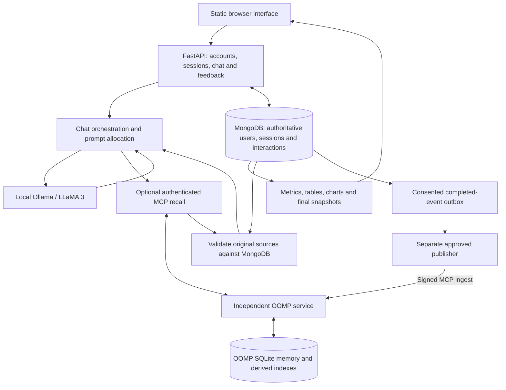

<div align="center">

# TRACE.AI

**Turn-based Response Analytics & Chat Engine**

Local conversations. Persistent sessions. Inspectable feedback.

A LLaMA-powered chatbot with session analytics and optional, source-verified
long-term memory through the independent OOMP engine.

[](#quickstart)
[](backend/app.py)
[](https://github.com/hamzah105/trace-ai-chatbot/actions/workflows/offline-ci.yml)

[Quickstart](#quickstart) · [Memory integration](#optional-long-term-memory) ·
[API](#api-at-a-glance) · [Documentation](#documentation) · [Limitations](#security-and-limitations)

</div>

## What TRACE does

TRACE keeps multi-turn conversations in MongoDB, collects structured feedback
after each response, and turns session history into readable analytics. Its
HTML/CSS/JavaScript interface is served by FastAPI; generation uses a local Ollama
HTTP endpoint with `llama3` as the default model.

For recall beyond the active conversation, TRACE can use
[OOMP](https://github.com/hamzah105/OOMP). The host checks retrieved evidence
against its authoritative MongoDB records before adding original source content
to a bounded prompt. OOMP remains a separate project and SQLite memory store.

This is a local research/development application. The memory-enabled profile
supports one explicitly approved owner; production multi-user deployment is not
certified.

## Features

| Area | Implemented behavior |
| --- | --- |
| Conversations | Persistent owned sessions, chronological history, session switching and ended-session write protection |
| Local generation | Ollama HTTP generation, configurable model/endpoint, measured response timing and explicit timeout/service errors |
| Feedback | Required rating, correctness and response-length feedback before the next chat; backend enforcement as well as UI controls |
| Analytics | Eight overview cards, seven charts and six tables over complete owned session history |
| Session finalization | Versioned final metrics snapshot, idempotent session ending and no silent rewrite of legacy ended sessions |
| Accounts | Bcrypt-backed local registration/login and implemented optional Google OAuth flow |
| Optional memory | Authenticated MCP retrieval, independent source-owner/provenance checks and separate approved publication worker |
| Adaptive context | Opt-in Context V1 allocation of complete exchanges and source units, bounded extractive views and explicit uncertainty/failure states |
| Local operation | Approved persistent connection discovery and a two-terminal OOMP/TRACE workflow |

Correctness metrics reflect submitted human feedback. They are not independent
fact checking or an automatic benchmark of model accuracy. Topic labels are
rules-based, not a trained classifier or inferred personal profile.

## Architecture



MongoDB is TRACE's interaction authority. OOMP's event/canonical-memory store is
independent; the outbox holds publication references and retry state rather than
a duplicate memory database. TRACE imports no OOMP implementation modules.

## Quickstart

### Prerequisites

- Python 3.11 or 3.12 and Git.
- A running local MongoDB instance.
- A running [Ollama](https://ollama.com/) service with the model selected by
  `OLLAMA_MODEL` already installed. Model acquisition is a separate explicit
  operator step; this application setup does not download weights.

Use a dedicated local development database. Startup connects to MongoDB and
ensures the application's indexes; it is not a read-only database inspection.

### Standalone chatbot: Windows / PowerShell

```powershell
git clone https://github.com/hamzah105/trace-ai-chatbot.git
cd trace-ai-chatbot
py -3.11 -m venv .venv
.\.venv\Scripts\Activate.ps1
python -m pip install -r requirements.txt
if (-not (Test-Path .env)) { Copy-Item sample.env .env }
uvicorn backend.app:app --reload
```

Run from the repository root so the frontend directory is found. On Linux/macOS,
create the environment with `python3.11 -m venv .venv` and activate it with
`source .venv/bin/activate`; use the same install and Uvicorn commands.

Open `http://127.0.0.1:8000/login.html`, register or sign in, and create a session.
Send a message, submit its feedback, then continue the conversation. End a session
when ready to inspect its finalized analytics. The dashboard is
`http://127.0.0.1:8000/analytics.html`; interactive API documentation is at `/docs`.

The browser assets need no frontend build or CDN. MongoDB, Ollama and the backend
must be available for their respective functions. Google OAuth additionally needs
internet access and a configured Google OAuth client.

### Configuration

The public [sample.env](sample.env) contains defaults and empty credential fields.
Copy it only when `.env` is absent; keep actual values private.

```dotenv
MONGO_URI=mongodb://localhost:27017/
MONGO_DB_NAME=trace_ai
OLLAMA_URL=http://localhost:11434/api/generate
OLLAMA_MODEL=llama3
OLLAMA_TIMEOUT_SECONDS=300
TRACE_OOMP_MODE=off
```

Local login works without Google configuration. To enable Google OAuth, configure
`GOOGLE_CLIENT_ID`, `GOOGLE_CLIENT_SECRET`, a fresh strong
`GOOGLE_OAUTH_STATE_SECRET`, and the exact callback
`http://127.0.0.1:8000/auth/google/callback`. The sample state-secret text is a
placeholder, not a deployment credential. Keep the browser on the configured
`127.0.0.1` origin.

Use TRACE's own environment for its server. Do not add OOMP's site-packages to
`PYTHONPATH`. The locally verified set is FastAPI 0.115.0, Starlette 0.38.6,
Uvicorn 0.54.0, Pydantic 2.14.1 and MCP 2.3.0. FastAPI's Starlette constraint is
`>=0.37.2,<0.39.0`; mixing in OOMP's newer Starlette reproduces a Router
`on_startup` error. Follow the declared requirements rather than independently
upgrading the web stack.

## Optional long-term memory

Normal chat history and long-term memory have different jobs. MongoDB retains
complete interactions; the ordinary prompt uses recent context. OOMP stores
approved source events and derives selectively retrievable memories outside the
model's finite prompt.

| `TRACE_OOMP_MODE` | Behavior |
| --- | --- |
| `off` | Standalone path; no MCP dependency or request is required |
| `retrieve` | Read authorized historical evidence before generation |
| `retrieve_and_ingest` | Retrieve and queue approved completed user/assistant/feedback events for the separate publisher |

`TRACE_OOMP_RETRIEVAL_API=retrieve` retains the legacy retrieval path.
`context_v1` explicitly selects the adaptive adapter: it loads a bounded
32-interaction current-session window, preserves mandatory context and feedback,
adds complete sources within the budget, and reports omissions. Up to two older
user-source views may be included extractively. Byte accounting is a conservative
context proxy, not measured tokenizer output or an expanded native model window.
An impossible mandatory request can still return HTTP 413.

The Context V1 client validates the wire contract, packet sizes and proofs. The
host then rechecks owner/session/role identity, timestamps, exact source spans and
exclusion/retraction policy against MongoDB. Uncertain, unavailable, unsupported
or empty recall remains explicit; wire summaries and object labels are not treated
as factual authority. Attribution does not establish external truth.

### Connect a reviewed OOMP installation

Install the optional client dependencies in TRACE's environment:

```powershell
python -m pip install -r requirements-oomp.txt
```

Install OOMP separately using the paired branch's
[source-install guide](https://github.com/hamzah105/OOMP/tree/feature/p4-retrieval-quality#installation).
With that supported OOMP command available, run `oomp start` in the OOMP terminal.
Its one-time wizard selects the TRACE project and validates the exact owner ID
you provide against that project's users collection. Your own register/login
response contains `user_id`; the wizard never chooses another user automatically.
Review the proposed read-only or approved-publication authority before applying.

After approved setup, the normal workflow uses two terminals:

```powershell
# OOMP terminal, using its own installed environment
oomp start
```

```powershell
# TRACE terminal, from the TRACE repository root
.\.venv\Scripts\Activate.ps1
uvicorn backend.app:app --reload
```

The managed OOMP supervisor owns MCP, Mind and the separately approved publisher.
It does not start MongoDB, Ollama or the TRACE API. The ignored private
`.oomp.local.json` references existing credentials, validates its signed profile
binding and enables Context V1. Approved settings precede legacy dotenv defaults;
foreign owners and conflicting process overrides fail closed. No secrets or
Python import paths are copied between terminals.

Use `oomp status`, `oomp doctor --full` and `oomp stop` for the selected managed
stack. [The workstation-specific quickstart](LOCAL-LIVE-QUICKSTART.md) records the
actual Windows paths and verification. For other approved deployments, see the
[complete MCP integration guide](docs/oomp-integration.md) and
[fictional Context V1 walkthrough](docs/oomp-p4b-fictional-quickstart.md).

## API at a glance

| Method | Route | Purpose |
| --- | --- | --- |
| GET | `/health` | Backend health |
| POST | `/register`, `/login` | Local account registration/login |
| GET | `/auth/google/status`, `/auth/google/login` | Optional OAuth readiness/start |
| GET | `/auth/google/callback`, `/auth/google/session` | OAuth callback and login handoff |
| POST | `/auth/oomp/logout` | Clear the memory-owner login cookie |
| POST | `/sessions/create` | Create an owned session |
| GET | `/sessions/user/{user_id}` | List sessions |
| GET | `/sessions/{session_id}` | Retrieve an owned session |
| GET | `/sessions/{session_id}/messages` | Retrieve chronological history |
| POST | `/chat` | Generate and persist an interaction |
| POST | `/feedback` | Submit required feedback |
| POST | `/sessions/{session_id}/end` | Finalize and close a session |
| GET | `/analytics/session/{session_id}` | Normalized analytics data |
| GET | `/analytics/session/{session_id}/metrics` | Feedback/timing/topic metrics |
| GET | `/analytics/session/{session_id}/tables` | Six analytics tables |
| GET | `/analytics/session/{session_id}/charts` | Seven chart specifications |
| GET | `/analytics/session/{session_id}/dashboard` | Complete dashboard payload |

Session/history/analytics reads require `user_id` as documented by `/docs`;
create/end/chat/feedback carry ownership identifiers in their request bodies.
Pending feedback and ended-session writes return 409; missing/wrong-owner sessions
are distinguished from database, model and context-capacity failures.

## Validation and project evolution

TRACE began as a CS619 final-year project at Virtual University of Pakistan.
Registration/chat storage, owned sessions/feedback, and full-history analytics
were followed by optional authenticated OOMP integration, adaptive Context V1
allocation and persistent approved local startup. Historical reports remain dated
records; they are not rewritten as claims about the current checkout.

| Evidence | Scope |
| --- | --- |
| [Phase 3 validation](docs/phase3-part5-validation.md) | Session analytics/finalization and historical acceptance |
| [Stage 8 validation](docs/stage8-validation.md) | Earlier MCP, persistence and synthetic live checks |
| [P4B report](docs/product-milestone-P4B-report.md) | Adaptive prompts, provenance and frozen synthetic evaluation |
| [Hosted CI policy](docs/P4B-hosted-CI.md) | Windows/Ubuntu Python 3.11/3.12 matrix, frozen bytes, explicit service exclusions and frontend checks |
| [Local startup verification](LOCAL-LIVE-QUICKSTART.md) | Actual activated reload `/health` 200; 62 focused TRACE passes; real browser/model follow-up remains manual |

For the pinned offline CI selection, install `requirements-ci.txt` and follow
[the guarded CI guide](docs/P4B-hosted-CI.md). External MCP/physical-Mongo tests are
separate explicit checks; a plain unfiltered pytest run may discover them. The CI
badge reports the workflow's actual branch status; earlier green runs do not
certify a newer commit. No general answer-quality or competitor superiority claim
is made.

## Security and limitations

- Keep the development listener on loopback and run one Uvicorn application worker.
  Session lifecycle locks are process-local and do not coordinate arbitrary other
  processes or direct database writers.
- Standalone operation retains the supplied-user-ID ownership contract. Local
  login is not a production authorization layer for every API request.
- Memory-enabled operation adds a verified pinned-owner cookie/admin-key boundary
  for memory, history and analytics. It is a trusted single-owner local profile,
  not general production multi-user isolation.
- Keep `.env`, private handoffs, credentials, MongoDB exports, OOMP databases,
  conversations, model weights and diagnostic evidence out of public Git history.
  MongoDB and OOMP backups need their own access controls and retention policies.
- Feedback accuracy is user-reported. Topic rules are limited. Retrieval can miss
  evidence, and a model can misinterpret valid evidence. Full P4 comparative model
  acceptance, independent pilots and general multi-principal scheduling remain open.
- Browser/OAuth login and cross-session model answers were not certified by the
  latest reload/health smoke. See [memory security](docs/oomp-security.md).

## Documentation

| Start here | Deeper reference |
| --- | --- |
| [Local live quickstart](LOCAL-LIVE-QUICKSTART.md) | [MCP integration and operations](docs/oomp-integration.md) |
| [Fictional Context V1 walkthrough](docs/oomp-p4b-fictional-quickstart.md) | [P4B design and limits](docs/P4B-implementation-plan.md) |
| [Security/privacy](docs/oomp-security.md) | [Phase 3 analytics acceptance](docs/phase3-part5-validation.md) |
| [CI and test classification](docs/P4B-hosted-CI.md) | [Historical Stage 8 report](docs/stage-8-report.md) |

## Contributing and reuse

Use fictional fixtures and keep service-dependent checks separate. Describe the
trigger, expected behavior, environment and focused validation in issues or pull
requests; never attach personal chats or secrets. Changes to authentication,
consent, outbox identity or source proofs require explicit compatibility review.

No repository `LICENSE` file is present in this checkout, so this README does not
assert an open-source license grant. Contact the maintainer before reuse or
redistribution; OOMP's separate license does not automatically license TRACE.
